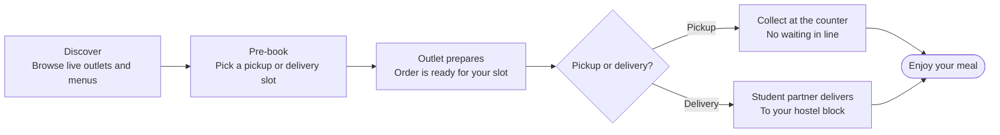
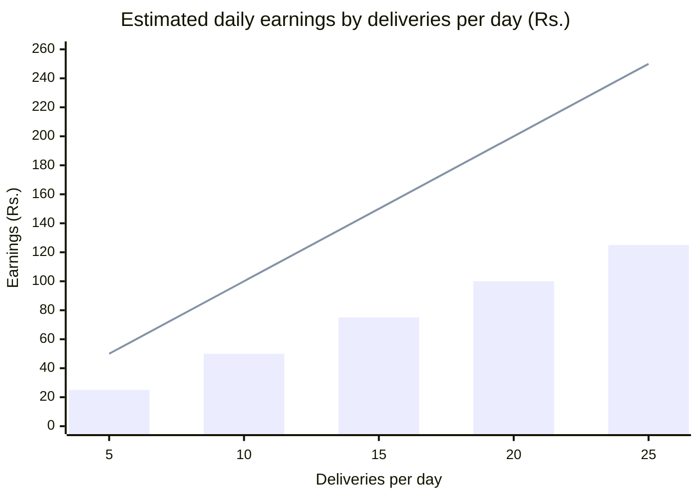
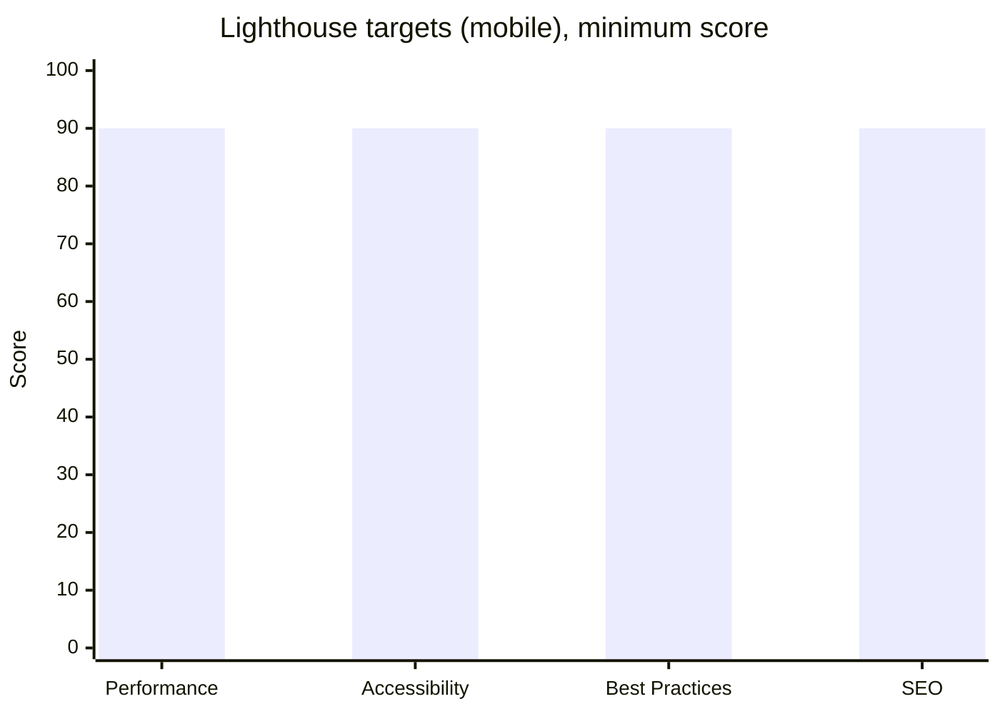
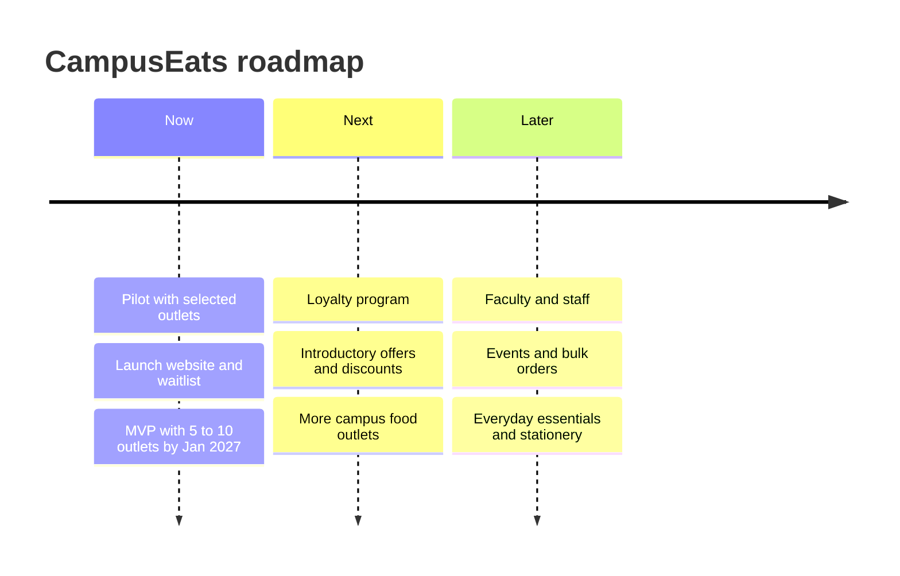

<div align="center">

# CampusEats

**Simplifying campus food — quick, reliable and affordable food delivery from VIT-AP Food Street to your doorstep.**


[Overview](#overview) · [Features](#features) · [Tech Stack](#tech-stack) · [Getting Started](#getting-started) · [Configuration](#configuration) · [Deployment](#deployment) · [Roadmap](#roadmap)

</div>

---

## Table of Contents

1. [Overview](#overview)
2. [Features](#features)
3. [How CampusEats Works](#how-campuseats-works)
4. [Tech Stack](#tech-stack)
5. [Design System](#design-system)
6. [Project Structure](#project-structure)
7. [Getting Started](#getting-started)
8. [Configuration](#configuration)
9. [Waitlist API](#waitlist-api)
10. [Delivery Partner Earnings](#delivery-partner-earnings)
11. [Performance and Quality Targets](#performance-and-quality-targets)
12. [Deployment](#deployment)
13. [Roadmap](#roadmap)
14. [Content and Data Policy](#content-and-data-policy)
15. [Credits](#credits)
16. [License and Contact](#license-and-contact)

---

## Overview

Campus life runs on tight schedules, and Food Street runs on long queues. **CampusEats** is a campus-specific food delivery platform for **VIT-AP students (UG and PG)** that connects hungry students, campus food outlets and student delivery partners on one platform.

This repository contains the **CampusEats launch website**: the public landing page, the waitlist for students, outlets and delivery partners, and the brand and design foundation for the upcoming app.

| | |
|---|---|
| **Promise** | Fast, reliable and convenient food delivery from campus outlets to your doorstep |
| **Audience** | VIT-AP students (UG and PG), campus food outlets, student delivery partners |
| **Pricing** | Free to join. Delivery fee Rs. 10 to 20 per order |
| **Stage** | Pre-launch. MVP with 5 to 10 campus outlets planned for January 2027 |
| **Primary CTA** | Join the waitlist |

### Why CampusEats

| Advantage | What it means |
|---|---|
| Campus-specific platform | Built around VIT-AP Food Street, hostels and class schedules |
| Real-time outlet availability | See which outlets are open, busy or closed before you order |
| Student delivery network | Fellow students deliver across campus and earn per delivery |
| Strong outlet partnerships | Outlets get advance orders and fewer counter crowds |
| Lower delivery time and cost | Short campus distances keep delivery quick and affordable |

---

## Features

### For students
- Browse campus outlets with live open, busy and closed status
- Pre-book a pickup or delivery time slot between classes
- Choose pickup from the counter or delivery to the hostel block
- Join the waitlist in seconds with a VIT-AP email or phone number

### For campus outlets
- Showcase products digitally
- Receive advance orders and prepare them by scheduled slot
- Reduce counter congestion and handle peak hours
- Apply to become a partner outlet from the site

### For delivery partners
- Earn Rs. 5 to Rs. 10 per delivery in your free time
- Built-in earnings calculator to estimate daily, weekly and monthly income

### Website experience
- Fully responsive layout, tested at 375, 768, 1024 and 1440 px
- Smooth scrolling, staggered text reveals, marquees and a hero carousel
- Watch Demo modal with a food-themed walkthrough video
- Striped CAMPUSEATS footer wordmark with a one-time reveal animation
- Accessible by default: semantic HTML, keyboard navigation, visible focus, reduced-motion support
- SEO ready: meta tags, Open Graph, sitemap, robots and JSON-LD

---

## How CampusEats Works



| Step | What happens |
|---|---|
| **1. Explore** | Browse live menus, breakfast specials, lunch combos and snacks from Food Street stalls |
| **2. Schedule** | Lock in a delivery or pickup window in advance so outlets prepare on schedule |
| **3. Enjoy** | Collect your packed meal without waiting, or let a student partner bring it to you |

---

## Tech Stack

| Layer | Technology | Purpose |
|---|---|---|
| Framework | **Next.js** (App Router) | Routing, rendering, API routes |
| Language | **TypeScript** | Type safety |
| Styling | **Tailwind CSS** | Design tokens and utility styling |
| Animation | **Framer Motion** | Reveals, carousels and modals |
| Smooth scroll | **Lenis** | Inertial scrolling |
| Fonts | **Londrina Solid**, **Andika**, **Inter**, **Archivo Black** | Display, accent, body and footer wordmark |
| Quality | **ESLint**, **Prettier** | Linting and formatting |

---

## Design System

The look is warm, bold and street-food inspired: dark brown and cream sections separated by torn-paper edges, with orange as the single action color.

### Color palette

| Token | Hex | Swatch | Usage |
|---|---|---|---|
| Cream | `#FFEFD9` |  | Light sections, text on dark |
| Brown | `#401500` |  | Dark sections, text on cream |
| Orange | `#FF9500` |  | Buttons, highlights, badges |
| Logo orange | `#E05A0C` |  | The "EATS" part of the wordmark |
| Footer dark | `#120804` |  | Footer background |

### Typography

| Role | Font |
|---|---|
| Display headings | Londrina Solid |
| Accents and labels | Andika |
| Body text | Inter |
| Footer wordmark | Archivo Black |

---

## Project Structure

```text
campuseats/
├── app/
│   ├── api/
│   │   └── waitlist/
│   │       └── route.ts          # POST /api/waitlist
│   ├── layout.tsx                # Fonts, metadata, JSON-LD
│   ├── page.tsx                  # Landing page (assembles all sections)
│   ├── globals.css
│   ├── sitemap.ts
│   └── robots.ts
├── components/
│   ├── AnnouncementBar.tsx
│   ├── Navbar.tsx
│   ├── Footer.tsx
│   ├── FooterWordmark.tsx        # Striped CAMPUSEATS wordmark
│   ├── footer-wordmark.css
│   ├── WaitlistModal.tsx
│   ├── DemoModal.tsx             # Watch Demo video modal
│   └── Marquee.tsx
├── sections/
│   ├── Hero.tsx
│   ├── About.tsx
│   ├── HowItWorks.tsx
│   ├── Outlets.tsx
│   ├── EarnWithUs.tsx            # Delivery partner banner + calculator
│   ├── WhyCampusEats.tsx
│   ├── Proof.tsx
│   ├── Partners.tsx
│   ├── Roadmap.tsx
│   ├── FinalCta.tsx
│   └── Contact.tsx
├── data/
│   ├── sample-outlets.ts         # SAMPLE DATA, replace with real outlets
│   └── testimonials.ts           # SAMPLE DATA, hidden by default
├── lib/
│   ├── constants.ts              # Brand, contact and feature flags
│   ├── placeholder-images.ts     # Temporary images to replace
│   └── validators.ts
├── public/
│   ├── media/
│   │   ├── campuseats-demo.mp4
│   │   └── campuseats-demo-poster.jpg
│   └── images/
│       └── how-it-works/
│           ├── step-1-explore.jpg
│           ├── step-2-schedule.jpg
│           └── step-3-enjoy.jpg
├── .env.example
└── README.md
```

---

## Getting Started

### Prerequisites

- **Node.js** 18.18 or newer (20 LTS recommended)
- **npm** 9+ (or pnpm / yarn)
- **Git**

### Installation

```bash
# 1. Clone the repository
git clone https://github.com/<your-username>/campuseats.git
cd campuseats

# 2. Install dependencies
npm install

# 3. Create your local environment file
cp .env.example .env.local

# 4. Start the development server
npm run dev
```

Open the application in your browser.

### Scripts

| Command | Description |
|---|---|
| `npm run dev` | Start the development server with hot reload |
| `npm run build` | Create an optimized production build |
| `npm run start` | Serve the production build |
| `npm run lint` | Run ESLint |
| `npx tsc --noEmit` | Type-check the whole project |

Before opening a pull request, make sure all three pass: `npm run lint`, `npx tsc --noEmit` and `npm run build`.

---

## Configuration

Brand, contact details and feature flags live in one place: **`lib/constants.ts`**.

| Constant | Default | Description |
|---|---|---|
| `BRAND_NAME` | `CampusEats` | Used in navbar, footer, meta tags, forms and alt text |
| `TAGLINE` | `Quick. Reliable. Affordable.` | Marquee and end card tagline |
| `CONTACT_EMAIL` | `info@campuseats.com` | Contact section and footer |
| `WHATSAPP_URL` | `https://wa.me/<number>` | **Replace with the real number** |
| `SOCIAL_LINKS` | Instagram, LinkedIn, X | **Replace with real profile URLs** |
| `LAUNCH_LABEL` | `Launching Jan 2027` | Announcement bar |
| `SHOW_TESTIMONIALS` | `false` | Turn on only when real, approved testimonials exist |

### Environment variables

Copy `.env.example` to `.env.local` and adjust:

```bash
# Public site URL (used for sitemap, Open Graph and canonical links)
NEXT_PUBLIC_SITE_URL=https://campuseats.com
```

Never commit `.env.local` or any secret keys.

---

## Waitlist API

The waitlist form posts to a Next.js route handler.

**`POST /api/waitlist`**

```json
{
  "name": "Aarav Kumar",
  "contact": "aarav.23abc1234@vitapstudent.ac.in",
  "role": "student"
}
```

| Field | Type | Rules |
|---|---|---|
| `name` | string | Required, 2 to 80 characters |
| `contact` | string | Required, a valid email or a 10-digit phone number |
| `role` | enum | `student`, `outlet` or `partner` |

| Status | Body | Meaning |
|---|---|---|
| `201` | `{ "ok": true }` | Saved |
| `400` | `{ "ok": false, "errors": { ... } }` | Validation failed |
| `500` | `{ "ok": false }` | Server error |

> **Important:** the default storage is a local JSON file, which is fine for development only. Serverless platforms do not keep local files between requests. Before launch, connect a real store (for example Supabase, Firebase, Airtable or a Google Sheets webhook) inside `app/api/waitlist/route.ts`.

---

## Delivery Partner Earnings

Delivery partners earn **Rs. 5 to Rs. 10 per delivery**. The chart below is simple arithmetic from those two numbers, the same math used by the on-site calculator. The bars show the low end (Rs. 5) and the line shows the high end (Rs. 10).



| Deliveries / day | Daily | Weekly (x7) | Monthly (x30) | Daily range |
|---:|---:|---:|---:|:---|
| 5 | Rs. 25 – 50 | Rs. 175 – 350 | Rs. 750 – 1,500 | `██` |
| 10 | Rs. 50 – 100 | Rs. 350 – 700 | Rs. 1,500 – 3,000 | `████` |
| 15 | Rs. 75 – 150 | Rs. 525 – 1,050 | Rs. 2,250 – 4,500 | `██████` |
| 20 | Rs. 100 – 200 | Rs. 700 – 1,400 | Rs. 3,000 – 6,000 | `████████` |
| 25 | Rs. 125 – 250 | Rs. 875 – 1,750 | Rs. 3,750 – 7,500 | `██████████` |

> These are illustrative estimates, not a guarantee of income. Actual earnings depend on order volume and availability.

---

## Performance and Quality Targets

These are the **targets** the site is built and reviewed against. Run Lighthouse (Chrome DevTools, mobile mode) on the production build and record results in the table below.



| Category | Target | Latest audit |
|---|:---:|:---:|
| Performance | 90+ | _to be recorded_ |
| Accessibility | 90+ | _to be recorded_ |
| Best Practices | 90+ | _to be recorded_ |
| SEO | 90+ | _to be recorded_ |

### Core Web Vitals ("good" thresholds)

| Metric | Target |
|---|:---:|
| Largest Contentful Paint (LCP) | 2.5 s or less |
| Interaction to Next Paint (INP) | 200 ms or less |
| Cumulative Layout Shift (CLS) | 0.1 or less |

### Quality checklist

- [x] Responsive at 375, 768, 1024 and 1440 px with no horizontal scroll
- [x] Semantic HTML, alt text and visible focus states
- [x] Keyboard-accessible menu and modals
- [x] `prefers-reduced-motion` respected
- [x] Videos play only when visible and are lazy loaded
- [x] Open Graph, sitemap, robots and JSON-LD
- [ ] WCAG AA contrast verified on the final palette
- [ ] Final Lighthouse audit recorded above

---

## Roadmap



| Phase | Focus | Status |
|---|---|:---:|
| **Now** | Pilot with selected outlets, launch website and waitlist, MVP by January 2027 | In progress |
| **Next** | Loyalty program, introductory offers, more outlets | Planned |
| **Later** | Faculty, staff, events and bulk orders, everyday essentials and stationery | Planned |

---

## Content and Data Policy

- **Sample data** (`data/sample-outlets.ts`, `data/testimonials.ts`, `lib/placeholder-images.ts`) exists only to demonstrate the design. It must be replaced with real, approved content before launch.
- **No unverified statistics** are shown on the site. Proof points stay qualitative until real numbers exist.
- **Internal business information** (unit economics, targets, commission terms, market sizing) is intentionally **not** stored in this repository or shown on the public site.
- Waitlist submissions contain personal data. Collect only what the form needs, store it securely and never commit exported submissions to Git.

---

## Credits

- **Design direction:** layout and styling inspired by the Hotbite Framer template. Replace any remaining template imagery before launch.
- **Food footage and stills:** AI-generated with Google Gemini.
- **Fonts:** Londrina Solid, Andika, Inter and Archivo Black via Google Fonts (SIL Open Font License).
- **Built with:** Next.js, Tailwind CSS, Framer Motion and Lenis.

---

## License and Contact

Copyright © 2026 CampusEats. All rights reserved.

<!-- Remove the next line if CampusEats is officially approved by VIT-AP. -->
CampusEats is an independent student venture and is not officially affiliated with VIT-AP University.

| | |
|---|---|
| **Email** | info@campuseats.com |
| **Location** | VIT-AP Campus, Amaravati, Andhra Pradesh |

<div align="center">

**Eat. Shop. Deliver. Earn.**

</div>
